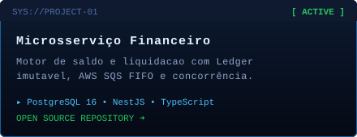
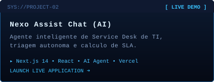
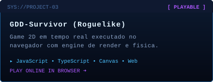

<!-- BANNER PIXEL ART COM RADAR E NOME -->

  

<!-- TYPING ANIMADO ESTILO TERMINAL RADAR -->

  

<!-- DIVISOR ESTILO STORM -->

  

<!-- PAINEL DE TELEMETRIA DO DIOGO ADAPTADO PARA MICKAEL -->

  

  

<!-- PAINEL DE STACK COMPLETA DO SISTEMA -->

  

  

<!-- CARDS DOS PROJETOS REAIS -->

  
  

  

  

<!-- REDES SOCIAIS & CONTATO NO MESMO PADRÃO -->

  
  
  
  

