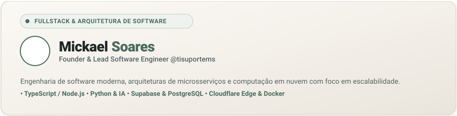
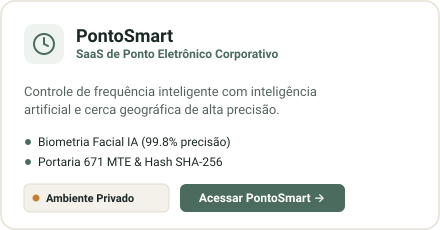
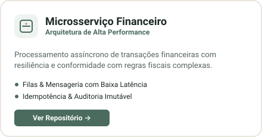
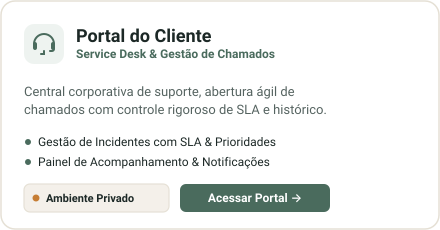
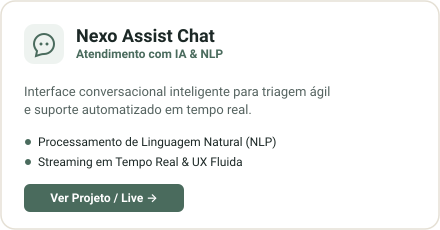

  

  
  &nbsp;
  
  &nbsp;
  
  &nbsp;
  

---

### Casos de Sucesso & Aplicações em Produção

  
  &nbsp;
  

  
  &nbsp;
  

  
  &nbsp;
  

---

### Tecnologias & Competências

#### Linguagens & Backend

  

#### Frontend & Mobile

  

#### Dados, Nuvem & Mensageria

  

#### Inteligência Artificial, Edge & Ferramentas

  

---

Várzea Grande - MT • Aberto a contratações e projetos corporativos • <a href="mailto:gumimds@gmail.com">gumimds@gmail.com</a>

