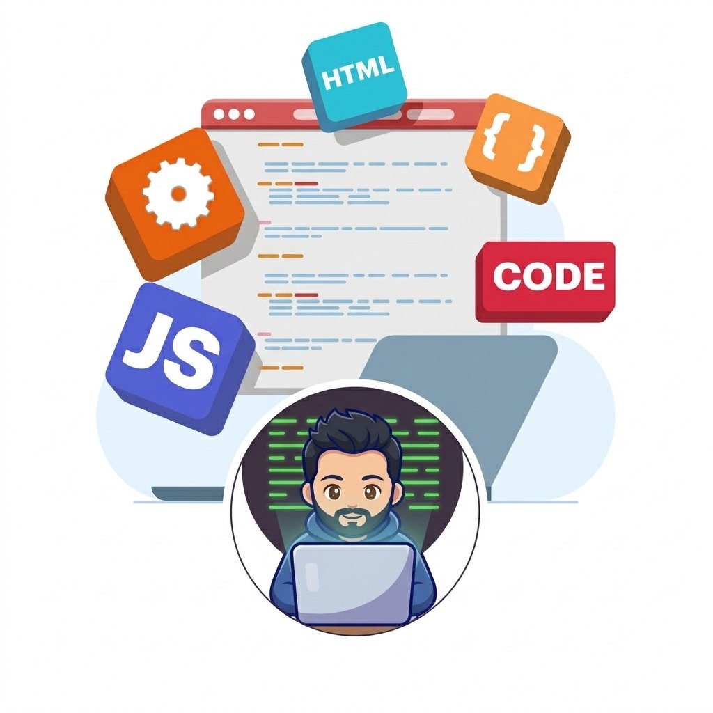

# Mickael Dias Soares
### Desenvolvedor Fullstack & Arquiteto de Software

Desenvolvo soluções digitais robustas, desde a infraestrutura do servidor até a tela do usuário. Uno uma sólida base prática em infraestrutura corporativa, redes e computação em nuvem com a engenharia de software moderna para construir sistemas resilientes, seguros e de alta performance, conectando regras de negócio complexas a uma experiência fluida para o usuário.

  
  
  
  

---

### ⚡ Tecnologias & Competências

#### 🖥️ Linguagens & Backend

  

#### 📱 Frontend & Mobile

  

#### 🗄️ Dados, Nuvem & Mensageria

  

#### 🤖 Inteligência Artificial, Edge & PWA

  

---

### 🚀 Casos de Sucesso & Aplicações em Produção

<table>
  <tr>
    <td style="border-left: 4px solid #10b981; padding: 14px 18px;">
      <h3 style="margin-top: 0;">🛡️ <a href="https://homologacao.tisuportems.com.br" target="_blank">PontoSmart — SaaS de Ponto Eletrônico &amp; Biometria Facial</a></h3>
      

        Sistema corporativo REP-P em conformidade com a <strong>Portaria 671 MTE e LGPD</strong>. Reconhecimento facial client-side via TensorFlow/Face-API no navegador, cerca geográfica GPS, arquitetura PWA Offline-First (IndexedDB), zero-polling com cache em memória RAM (0 ms de latência) e assinatura digital com Certificado A1 ICP-Brasil.
      

      <a href="https://homologacao.tisuportems.com.br" target="_blank"><strong>👉 Acessar Ambiente de Demonstração (Homologação) ➔</strong></a>
    </td>
  </tr>
</table>

 

<table>
  <tr>
    <td style="border-left: 4px solid #38bdf8; padding: 14px 18px;">
      <h3 style="margin-top: 0;">🏦 <a href="https://github.com/mickael-soares/microsservico-financeiro" target="_blank">Microsserviço Financeiro Distribuído</a></h3>
      

        Processamento de saldo e liquidação financeira de alta concorrência. Garantia de atomicidade e integridade contábil via <strong>Ledger imutável (append-only)</strong>, locks pessimistas no PostgreSQL (<code>SELECT ... FOR UPDATE</code>), idempotência persistente (SHA-256) e mensageria assíncrona <strong>AWS SQS FIFO</strong> com Transactional Outbox.
      

      <a href="https://github.com/mickael-soares/microsservico-financeiro" target="_blank"><strong>👉 Ver Código Fonte &amp; Arquitetura ➔</strong></a>
    </td>
  </tr>
</table>

 

<table>
  <tr>
    <td style="border-left: 4px solid #a855f7; padding: 14px 18px;">
      <h3 style="margin-top: 0;">🤖 <a href="https://desafio-nexo-assist-iota.vercel.app/chat" target="_blank">Nexo Assist — Agente de Suporte TI</a></h3>
      

        Plataforma conversacional com IA para automação de Service Desk corporativo. Triagem autônoma de incidentes, motor híbrido de decisão, cálculo dinâmico de SLAs e transição fluida de contexto para atendimento humano.
      

      <a href="https://desafio-nexo-assist-iota.vercel.app/chat" target="_blank"><strong>👉 Acessar Live Demo na Vercel ➔</strong></a>
    </td>
  </tr>
</table>

 

<table>
  <tr>
    <td style="border-left: 4px solid #f59e0b; padding: 14px 18px;">
      <h3 style="margin-top: 0;">🎮 <a href="https://gdd-survivor.vercel.app/" target="_blank">GDD-Survivor — Jogo 2D no Navegador</a></h3>
      

        Aplicação interativa em tempo real com renderização gráfica e física 2D. Gerenciamento otimizado de loop de eventos, lógica de colisão e hordas dinâmicas, deploy contínuo na Vercel.
      

      <a href="https://gdd-survivor.vercel.app/" target="_blank"><strong>👉 Jogar no Navegador ➔</strong></a>
    </td>
  </tr>
</table>

---

Cuiabá / Várzea Grande - MT • Aberto a contratações e projetos corporativos • gumimds@gmail.com

